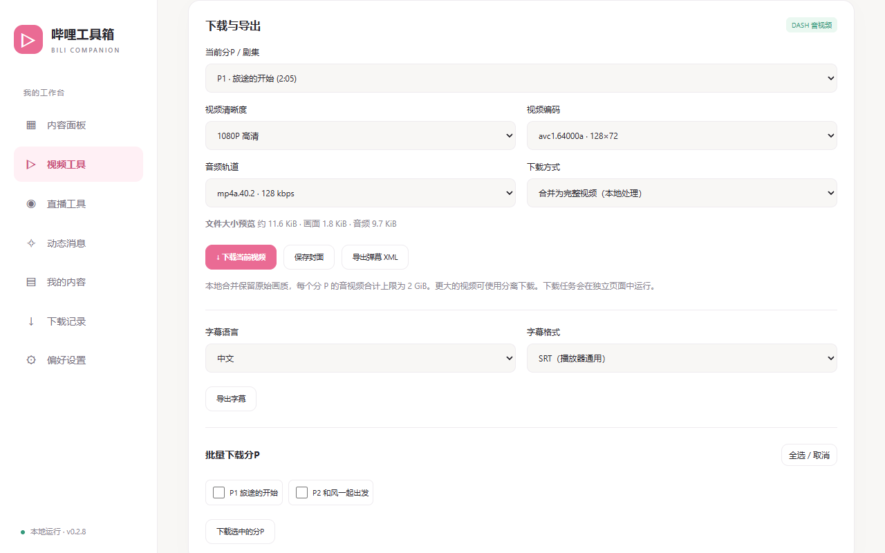
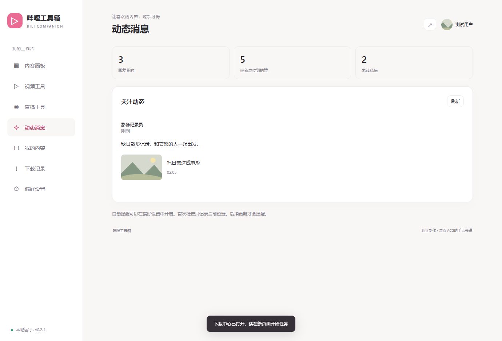

# 哔哩工具箱 · Bili Companion

哔哩工具箱是面向 Microsoft Edge 的 B 站扩展。点击工具栏图标即可打开内容面板，也可以从视频页和直播页使用下载、播放与录制工具。

[下载 v0.2.8 安装包](https://github.com/38530756/bili-companion-edge/releases/download/v0.2.8/bili-companion-edge-store-v0.2.8.zip) · [版本说明](https://github.com/38530756/bili-companion-edge/releases/tag/v0.2.8) · [隐私政策](https://bili-companion-privacy.qq38530756.chatgpt.site/)

## 主要功能

- **B 站内容面板** · 查看关注动态、开播信息、推荐、番剧时间表和分区排行。登录 B 站后可浏览收藏、稍后再看、观看历史和追番，并按需调整面板栏目。
- **视频下载与导出** · 选择分 P、清晰度、编码和音轨，下载前预览文件大小。支持批量下载、自选保存文件夹和本地合并音视频，也可保存封面、导出字幕和弹幕 XML。
- **播放工具** · 在 B 站视频页调整倍速、开启画中画或截取当前画面。
- **直播录制** · 解析直播间并手动录制可用的 FLV 直播流，录制文件保存在本机。
- **消息提醒** · 按需开启关注动态、未读消息和开播提醒，设置检查间隔和免打扰时段。提醒默认关闭。

## 界面示例

### 视频下载与导出

选好分 P、画质和音轨后，可在下载按钮上方查看预计大小，再选择单个分 P 或批量下载。

### 动态消息

在「动态消息」查看关注动态和未读计数。下图为早期版本的演示界面，使用的是测试数据。

## 安装

1. 下载 Release 附件 `bili-companion-edge-store-v0.2.8.zip` 并解压。
2. 在 Edge 地址栏打开 `edge://extensions/`，开启「开发人员模式」。
3. 点击「加载解压缩的扩展」，选择包含 `manifest.json` 的文件夹。
4. 点击工具栏的「扩展」按钮，打开或固定「哔哩工具箱」。

## 使用方法

### 浏览内容和设置提醒

在 Edge 中登录 B 站后，点击插件图标进入内容面板。要接收通知，可在「偏好设置」中开启所需提醒，并设置检查间隔和免打扰时段。

### 下载视频或导出字幕

1. 在 B 站视频页打开哔哩工具箱，或在「视频工具」粘贴视频链接并点击「解析视频」。
2. 在「下载与导出」选择分 P、清晰度和音轨，查看文件大小后点击「下载当前视频」。有多个分 P 时，也可以勾选后批量下载。字幕可用时，可选择语言和格式后单独导出。
3. 在下载任务页选择「选择保存文件夹」，然后开始下载。合并模式下，每个分 P 的音视频输入合计上限为 2 GiB。需要单独保存音频和视频时，可在「下载方式」里选分离下载。

### 录制直播

在「直播工具」打开正在开播的房间，解析后选择可用的 FLV 线路，点击「录制直播」。录制期间保持下载中心页面打开，完成后点击停止并保存。

请仅对自有内容或已获许可的内容使用下载、导出和录制功能。可用画质、字幕和直播线路取决于 B 站返回的资源。
